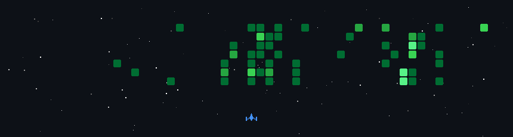

 

<picture>
  <source media="(prefers-color-scheme: light)" srcset="https://readme-typing-svg.demolab.com?font=Fira+Code&weight=600&size=22&pause=1000&color=059669&center=true&vCenter=true&width=900&height=55&lines=Building+RAG+pipelines+%26+Agentic+AI+workflows;Turning+LLM+ideas+into+useful+applications;Exploring+LangChain+%7C+LangGraph+%7C+Multi-Agent+Systems;Combining+AI+engineering+with+software+fundamentals">
  
</picture>

 

 

 

  
  
  
  
  
  

  
  
  
  
  

  
  
  
  

---

<h1 align="center">🎬 It's Intro Time</h1>

### I'm a Computer Science student focused on building useful AI applications — from retrieval pipelines and LLM-powered tools to stateful agent workflows.

I like understanding how systems work end to end: how data enters an application, how it is processed, how an AI component makes use of it, and how the final experience becomes useful to a real person. My current learning and building direction is **Generative AI and Agentic AI**, supported by a foundation in **C++, DSA and full-stack development**.

### What I build

- **AI applications:** RAG-based document assistants, video understanding workflows, research assistants and career-focused AI tools.
- **Agentic workflows:** Tool calling, LangGraph state, sequential/parallel/conditional flows, persistence and multi-agent orchestration.
- **Applied problem solving:** Defensive URL and scam analysis, explainable outputs and evaluation-focused engineering.
- **Full-stack products:** React, TypeScript, Node.js, Express, FastAPI and database-backed applications.
- **Engineering foundations:** C++, data structures, algorithms, APIs, databases and practical software design.

### What I care about

Building beyond a prompt-and-response demo, keeping claims measurable, documenting limitations honestly, and turning what I learn into working software.

---

## 🧭 Overview

<table>
  <tr>
    <td width="50%" valign="top">
      <h3>🧠 Generative & Agentic AI</h3>
      LLM applications, prompt engineering, structured outputs, tool calling, LangChain, LangGraph, stateful workflows, memory and multi-agent patterns.
    </td>
    <td width="50%" valign="top">
      <h3>🔎 RAG & Knowledge Systems</h3>
      Document ingestion, chunking, embeddings, vector stores, retrieval, conversational RAG and source-grounded responses.
    </td>
  </tr>
  <tr>
    <td width="50%" valign="top">
      <h3>🌐 Full-Stack Engineering</h3>
      React, Next.js, TypeScript, JavaScript, Node.js, Express, FastAPI, REST APIs and MongoDB-backed applications.
    </td>
    <td width="50%" valign="top">
      <h3>🛡️ Applied AI & Security</h3>
      URL classification, scam-signal analysis, explainable risk scoring, defensive security tooling and evaluation workflows.
    </td>
  </tr>
</table>

---

## 🛠 Skills

 

 

  

| Area | Technologies & concepts |
| :--- | :--- |
| **Languages** | C++ · Python (working knowledge) · JavaScript · TypeScript · SQL |
| **AI / LLM** | Generative AI · LLM APIs · Gemini · Groq · OpenRouter · Hugging Face · Ollama |
| **Agentic AI** | LangChain · LangGraph · LangSmith · Tool Calling · Stateful Workflows · Multi-Agent Systems |
| **RAG & Search** | Embeddings · Vector Databases · FAISS · ChromaDB · Pinecone · Retrieval Pipelines |
| **Backend** | FastAPI · Node.js · Express · REST APIs |
| **Frontend** | React · Next.js · HTML · CSS · Tailwind CSS |
| **Databases** | MongoDB · MySQL · SQLite · Firebase |
| **Engineering** | DSA · OOP · Git · GitHub · Docker · Postman · Vercel · Railway |

---

## 📂 Featured Projects

<table>
  <tr>
    <td width="50%" valign="top">
      <h3 align="center">🛡️ <a href="https://github.com/udayrastogi0531/Ai-digital-scam-investigator">AI Digital Scam Investigator</a></h3>
      
<b>Evidence-first Cybersecurity Investigation System</b>

      <ul>
        <li><b>Stack:</b> Python, FastAPI, LangGraph, scikit-learn, Next.js, TypeScript</li>
        <li>Investigates suspicious messages, URLs and screenshots through explainable risk signals.</li>
        <li>Repository reports 198 passing tests and 11 skipped tests.</li>
      </ul>
    </td>
    <td width="50%" valign="top">
      <h3 align="center">📄 <a href="https://github.com/udayrastogi0531/ResumeForge-AI">ResumeForge AI</a></h3>
      
<b>LaTeX-first Resume Engineering Workspace</b>

      <ul>
        <li><b>Stack:</b> Next.js, TypeScript, FastAPI, Python, Groq</li>
        <li>Job-description analysis, ATS-oriented feedback, tailored resume versions and cover-letter workflows.</li>
        <li>Preserves the source resume and supports review of generated changes.</li>
      </ul>
    </td>
  </tr>
  <tr>
    <td width="50%" valign="top">
      <h3 align="center">📈 <a href="https://github.com/udayrastogi0531/Trade-Saarthi">Trade-Saarthi</a></h3>
      
<b>Risk-aware Trading Research Platform</b>

      <ul>
        <li><b>Stack:</b> Python, FastAPI, Next.js, Streamlit, PostgreSQL, Redis</li>
        <li>Market research, strategy analysis, portfolio risk views and validation workflows.</li>
        <li>Paper-trading and execution safety controls are documented in the repository.</li>
      </ul>
    </td>
    <td width="50%" valign="top">
      <h3 align="center">🔎 <a href="https://github.com/udayrastogi0531/WebLens">WebLens</a></h3>
      
<b>Machine-learning Powered Malicious URL Detection</b>

      <ul>
        <li><b>Stack:</b> Python, FastAPI, scikit-learn, Pandas, NumPy, TypeScript</li>
        <li>Random Forest classifier using 48 URL-derived features across four URL classes.</li>
        <li>Repository reports 91.68% unseen-domain accuracy and 89.65% macro F1.</li>
      </ul>
    </td>
  </tr>
  <tr>
    <td width="50%" valign="top">
      <h3 align="center">🧪 <a href="https://github.com/udayrastogi0531/Multi-Agent-Research-System">Multi-Agent Research System</a></h3>
      
<b>Research, Writing & Review Workflow</b>

      <ul>
        <li><b>Stack:</b> Python, LangChain, Groq, Tavily, Streamlit</li>
        <li>Multi-stage workflow for web research, source reading, drafting and critique.</li>
        <li>Separates research and review responsibilities into distinct stages.</li>
      </ul>
    </td>
    <td width="50%" valign="top">
      <h3 align="center">🎥 <a href="https://github.com/udayrastogi0531/AI-Video-Analyzer">AI Video Analyzer</a></h3>
      
<b>Multimodal Video Understanding & RAG</b>

      <ul>
        <li><b>Stack:</b> Python, Whisper, Mistral, ChromaDB, Streamlit</li>
        <li>Processes video/audio content and enables question answering over extracted information.</li>
        <li>Combines transcription, summarization and retrieval-oriented interaction.</li>
      </ul>
    </td>
  </tr>
  <tr>
    <td width="50%" valign="top">
      <h3 align="center">🧠 <a href="https://github.com/udayrastogi0531/Agentic-AI-LangGraph">Agentic AI with LangGraph</a></h3>
      
<b>Tool Calling & Stateful Workflow Patterns</b>

      <ul>
        <li><b>Stack:</b> Python, LangGraph, LangChain, Groq</li>
        <li>Hands-on workflows for graph state, tool routing and agent execution.</li>
        <li>Includes environment-based configuration for API credentials.</li>
      </ul>
    </td>
    <td width="50%" valign="top">
      <h3 align="center">💼 <a href="https://github.com/udayrastogi0531/AI-Career-Copilot-SkillSync-AI">SkillSync AI</a></h3>
      
<b>AI Career Copilot</b>

      <ul>
        <li><b>Stack:</b> React, Vite, Tailwind CSS, Node.js, Express, MongoDB, Gemini</li>
        <li>Resume analysis, job-description matching and AI-assisted interview preparation.</li>
        <li>Built around a career-readiness workflow.</li>
      </ul>
    </td>
  </tr>
  <tr>
    <td width="50%" valign="top">
      <h3 align="center">📚 <a href="https://github.com/udayrastogi0531/Pdf-Rag-Chatbot">PDF RAG Chatbot</a></h3>
      
<b>Document Question Answering</b>

      <ul>
        <li><b>Stack:</b> Python, Hugging Face embeddings, ChromaDB, Groq</li>
        <li>PDF ingestion, chunking, vector retrieval and conversational responses.</li>
      </ul>
    </td>
    <td width="50%" valign="top">
      <h3 align="center">🔤 <a href="https://github.com/udayrastogi0531/Hangman-Game">Hangman — C++</a></h3>
      
<b>Data Structures in a Working Game</b>

      <ul>
        <li><b>Stack:</b> C++</li>
        <li>Trie-based word and hint lookup with a max-heap leaderboard.</li>
        <li>Applies DSA concepts in a playable terminal project.</li>
      </ul>
    </td>
  </tr>
  <tr>
    <td colspan="2" align="center">
      <h3>📬 More Projects</h3>
      
    </td>
  </tr>
</table>

---

## 🔬 Research & Achievements

- Published research work related to the **Chatbot Legal Advisor** project.
- **AI-NCAT 2025:** Score 409/670; percentile highlights included Quantitative Aptitude 79.42, Logical Reasoning 80.63 and Grammar 87.58.
- Building practical experience across GenAI, RAG, agent orchestration, cybersecurity and full-stack development.
- Strengthening the engineering fundamentals behind reliable AI applications: DSA, DBMS, OS, Computer Networks, testing and backend design.

---

## 📊 GitHub Stats

  

### 🏙️ 3D Contribution City

  

### 🚀 Contribution Space Shooter

  

---

## 🔭 What I'm Up To

<table>
  <tr>
    <td width="33%" valign="top" align="center">
      <h4>🔨 Building</h4>
      RAG applications, career-focused AI tools and LangGraph agent workflows.
    </td>
    <td width="33%" valign="top" align="center">
      <h4>📚 Exploring</h4>
      Agentic AI, retrieval evaluation, multi-agent systems, LangSmith and practical AI automation.
    </td>
    <td width="33%" valign="top" align="center">
      <h4>🎯 Goal</h4>
      Ship useful, well-documented AI products and grow as an AI Systems Engineer.
    </td>
  </tr>
</table>

---

&nbsp;&nbsp;

  

<h2>👋 Thanks for stopping by! Let's build something useful together.</h2>

 

  

