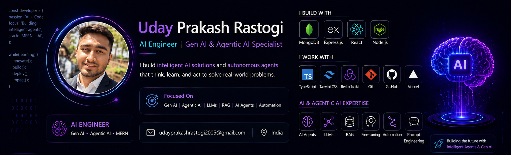

### Applied AI Engineer · Generative AI · Agentic Systems

**Building AI applications that connect retrieval, reasoning, tools and dependable software workflows.**

---

## 👋 Introduction

I'm a Computer Science and Engineering student focused on **Applied AI, Generative AI and Agentic AI**. My foundation is in **C++, Data Structures & Algorithms, databases and full-stack development**.

I enjoy building systems beyond a basic LLM chat interface: document ingestion, retrieval, tool execution, graph-based orchestration, persistence, evaluation, APIs and user-facing workflows.

- 🧠 **AI focus:** RAG, LLM applications, LangChain, LangGraph and agent workflows
- ⚙️ **Engineering foundation:** C++, DSA, OOP, REST APIs, databases and MERN
- 🔬 **Applied domains:** cybersecurity intelligence, career tools, document understanding and research workflows
- 🎯 **Career direction:** Applied AI / AI Engineering

## 🧭 Engineering Overview

<table>
<tr>
<td width="50%" valign="top">

### 🧠 AI & Agentic Systems
LLM application patterns, prompt design, structured outputs, tool calling, graph-based workflows, checkpointing, memory and tracing.

</td>
<td width="50%" valign="top">

### 🔎 Retrieval & Knowledge Systems
Document loading, chunking, embeddings, vector search, hybrid retrieval concepts, RAG pipelines and source-grounded responses.

</td>
</tr>
<tr>
<td width="50%" valign="top">

### 🛡️ Applied ML & Cybersecurity
URL classification, scam-signal analysis, explainable risk scoring, evaluation workflows and defensive security tooling.

</td>
<td width="50%" valign="top">

### 🌐 Software Engineering
React, Next.js, TypeScript, Node.js, Express, FastAPI, MongoDB, SQLite, API design and C++ problem solving.

</td>
</tr>
</table>

## 🛠️ Technology Stack

**Languages**

**AI, Data & Backend**

**Developer Tools**

| Area | Tools and concepts |
|---|---|
| **Generative AI** | LLM APIs, embeddings, structured outputs, prompt design |
| **Agentic AI** | LangChain, LangGraph, tool calling, stateful workflows |
| **RAG** | Document ingestion, chunking, vector search, retrieval and grounding |
| **Observability** | LangSmith tracing and debugging |
| **Backend** | FastAPI, Node.js, Express, REST APIs |
| **Frontend** | React, Next.js, TypeScript, HTML, CSS |
| **Data** | MongoDB, MySQL, SQLite, ChromaDB |
| **Engineering** | C++, DSA, OOP, Git, testing and API integration |

---

## 🚀 Selected Engineering Projects

### 🛡️ AI Digital Scam Investigator
**Evidence-first cybersecurity investigation system**

A multi-layer pipeline for investigating suspicious messages, URLs and screenshots. It combines URL analysis, linguistic signals, scam-pattern rules, entity extraction, machine learning and threat-intelligence inputs into an explainable risk report.

- Deterministic risk aggregation with evidence-oriented findings
- FastAPI backend, LangGraph orchestration and Next.js interface
- Repository README reports **198 passing tests and 11 skipped tests**
- Detection is decision support, not a guarantee; deployment status and integration limits are documented

**Stack:** Python · FastAPI · LangGraph · scikit-learn · Next.js · React · TypeScript · SQLite

[Repository](https://github.com/udayrastogi0531/Ai-digital-scam-investigator) · [Architecture](https://github.com/udayrastogi0531/Ai-digital-scam-investigator/blob/main/docs/ARCHITECTURE.md) · [Evaluation](https://github.com/udayrastogi0531/Ai-digital-scam-investigator/blob/main/docs/EVALUATION.md)

### ⚡ ResumeForge AI
**LaTeX-first resume engineering workspace**

A controlled resume workflow for editing LaTeX, extracting job-description requirements, analyzing ATS compatibility, generating tailored variants, reviewing source diffs and compiling PDFs.

- Keeps the original resume intact while creating tailored versions
- Deterministic ATS analysis and validation against unsupported claims
- Job-specific cover-letter workflow

**Stack:** Next.js · TypeScript · FastAPI · Python · Groq

[Repository](https://github.com/udayrastogi0531/ResumeForge-AI)

### 📊 Trade-Saarthi
**Risk-aware quantitative trading research platform**

A research-oriented platform for Indian equities with market scanning, strategy analysis, portfolio risk views, validation workflows and execution-safety controls.

- Walk-forward validation and overfitting/decay analysis
- Monte Carlo risk and drawdown analysis
- Portfolio analytics and execution simulation
- Safety-first operating modes documented in the repository

**Stack:** Python · FastAPI · Next.js · Streamlit · PostgreSQL · Redis

[Repository](https://github.com/udayrastogi0531/Trade-Saarthi)

### 🌐 WebLens
**Machine-learning powered malicious URL detection**

A defensive URL-analysis system with a FastAPI backend, machine-learning classifier and browser extension.

- Random Forest model using 48 URL-derived features
- Four classes: benign, defacement, malware and phishing
- Repository reports 641,152 URLs in the remediated dataset
- Reported unseen-domain evaluation: 91.68% accuracy and 89.65% macro F1

**Stack:** Python · FastAPI · scikit-learn · Pandas · NumPy · TypeScript

[Repository](https://github.com/udayrastogi0531/WebLens)

### 🤖 SkillSync AI
**AI career copilot**

A MERN application for resume analysis, job-description matching and AI-assisted interview preparation. The repository includes an implementation report and distinguishes local verification from cloud deployment status.

**Stack:** React · Vite · Tailwind CSS · Node.js · Express · MongoDB · Gemini

[Repository](https://github.com/udayrastogi0531/AI-Career-Copilot-SkillSync-AI)

### 🕸️ Agentic AI with LangGraph
**Workflow patterns and orchestration learning repository**

A hands-on reference covering sequential, parallel, conditional and iterative workflows, conversational state, persistence, streaming and observability.

**Stack:** Python · LangGraph · LangChain · Streamlit · LangSmith

[Repository](https://github.com/udayrastogi0531/Agentic_AI_using_LangGraph-Workflows)

### 🔤 Hangman — C++
A terminal game applying a **Trie** for word/hint lookup and a **max-heap** for leaderboard ranking.

[Repository](https://github.com/udayrastogi0531/Hangman-Game)

---

## 🔬 Research & Learning

- Published research work related to a **Chatbot Legal Advisor** project.
- Exploring practical RAG design, retrieval quality, agent orchestration and LLM evaluation.
- Strengthening software engineering fundamentals: DSA, DBMS, operating systems, networking, testing and backend design.

## 📈 GitHub Activity

## 📫 Connect

- **LinkedIn:** [Uday Prakash Rastogi](https://www.linkedin.com/in/uday-prakash-rastogi-33b55a2a2/)
- **Email:** [udayprakashrastogi2005@gmail.com](mailto:udayprakashrastogi2005@gmail.com)
- **GitHub:** [@udayrastogi0531](https://github.com/udayrastogi0531)

---

*Build carefully. Measure honestly. Keep learning.*

